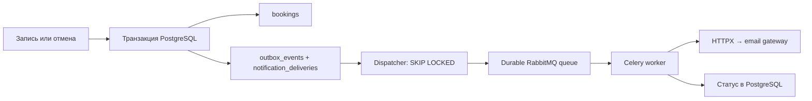

# Фоновые уведомления

Создание и первая отмена записи добавляют `outbox_events` и `notification_deliveries`
в той же PostgreSQL-транзакции. При rollback не остаётся ни записи, ни события.
Повторная отмена нового события не создаёт. В outbox нет контактов и manage token:
событие содержит UUID записи, тип и время. Получателя worker читает из bookings.
Секретная ссылка в письма не включается и по-прежнему сохраняется клиентом отдельно.



Dispatcher публикует только event_id, persistent message в durable queue, с publisher
confirm. После подтверждения фиксирует published_at. Сбой перед commit допускает
повторную публикацию. Каждые 30 секунд незавершённое событие снова становится
доступным для публикации, с учётом next_attempt_at. Поэтому потеря сообщения или
ошибка worker не оставляют событие навсегда зависшим на published.

Worker использует sync SQLAlchemy Session и HTTPX Client с connect timeout 3 секунды,
остальными timeout 10 секунд, без перенаправлений. Блокировка строки delivery
сериализует обработку одного события, а первичный ключ `(event_id, channel)` исключает
двойную запись доставки. `sent` и `failed` повторно автоматически не отправляются.

Сеть, 429 и 5xx повторяются до 5 зафиксированных попыток (`SLOTBOOK_NOTIFICATION_MAX_ATTEMPTS`). Backoff экспоненциальный
с jitter; Retry-After принимается в секундах или HTTP-date и ограничивается сутками.
Остальные HTTP-ошибки завершают доставку как failed. Повторы планируются в БД,
а не долгими Celery countdown. Непредвиденная ошибка откатывает попытку; dispatcher
впоследствии повторит событие. Падение процесса может не оставить счётчик попытки.

Статусы: pending, retrying, sent, failed. `sent` означает успешный HTTP-ответ gateway,
а не подтверждение получения письма человеком. В логах только event_id, статус или
безопасный код ошибки; текст исключения, контакты и ключ провайдера не выводятся.

## Граница гарантии доставки

Обработка использует at-least-once: доставка может повториться. Передаётся
`Idempotency-Key: <event_id>`. Сбой после принятия HTTP-запроса, но до commit delivery
приводит к повторному HTTP-вызову. Без idempotency на стороне gateway возможны
дублирующиеся письма; unique constraint в нашей БД этого не исправляет.
Гарантия относится к повторной обработке событий, а не к бесконечным попыткам:
после исчерпания бюджета доставка остаётся failed для ручного решения.

Сообщение описывает событие и его время, а не обещает актуальность статуса записи.
Создание и отмена могут быть доставлены в разном порядке при повторах.

## Локальный провайдер и внешний gateway

Production Compose включает RabbitMQ 4.1, dispatcher, worker и `mail-provider`.
RabbitMQ сохраняет очередь в volume `rabbit_data`, его порты не публикуются.
Локальный `mail-provider` принимает `POST /messages` и хранит только уникальные
idempotency identifiers в SQLite на tmpfs. Он не отправляет письма, не хранит их
текст/адресатов и не публикует порт. При пересоздании контейнера receipts очищаются.

Для настоящей отправки нужен совместимый gateway по `SLOTBOOK_EMAIL_URL`:

```json
{"to":"client@example.com","subject":"Запись создана","text":"..."}
```

Успех — 2xx. `SLOTBOOK_EMAIL_API_KEY` передаётся как Bearer, если задан; для внешнего
gateway используйте HTTPS и его поддержку Idempotency-Key. URL стороннего провайдера
с другим API требует адаптера под этот контракт. Настоящая внешняя доставка в комплекте
не проверена; наличие локального sink не означает, что письмо попало в почтовый ящик.
Перед подключением настоящего gateway проверьте накопленные pending/retrying:
worker обработает и старые события. API не подключается к брокеру/провайдеру при бронировании: их отказ не мешает commit.

## Запуск и диагностика

Для production задайте `RABBITMQ_PASSWORD` в `.env.production` (используйте случайный URL-safe пароль, например hex:
одно значение используется в AMQP URL и настройке RabbitMQ), примените Compose
команды README. Существующему volume RabbitMQ изменение env пароль не меняет.
Настройки gateway изменяются для worker; после смены env пересоздайте сервисы.

Для разработки `docker compose up -d --wait rabbitmq`, `make migrate`; затем
в отдельных терминалах из backend с установленным uv:

```bash
uv run --frozen python -m app.notifications.dispatcher
uv run --frozen celery -A app.notifications.queue:celery worker --concurrency=2 --loglevel=WARNING
```

`SLOTBOOK_BROKER_URL` по умолчанию указывает на локальный RabbitMQ Compose.
Задайте `SLOTBOOK_EMAIL_URL` для тестового gateway; если URL отсутствует, worker
фиксирует provider_not_configured и ограниченно повторяет попытки.

Просмотр последних 100 доставок и явный повтор одной failed-доставки (из backend):

```bash
uv run --frozen python -m scripts.notifications status
uv run --frozen python -m scripts.notifications retry --event-id <UUID>
```

В Docker используйте `docker compose --env-file .env.production -f compose.production.yaml
exec worker python -m scripts.notifications status` (одной строкой).
Повтор сбрасывает бюджет попыток; перед ним выясните причину сбоя и возможность
повторного письма. События и доставки входят в PostgreSQL backup. Их срок хранения
задаётся отдельно; автоматическое удаление и будущие напоминания здесь не реализованы.
