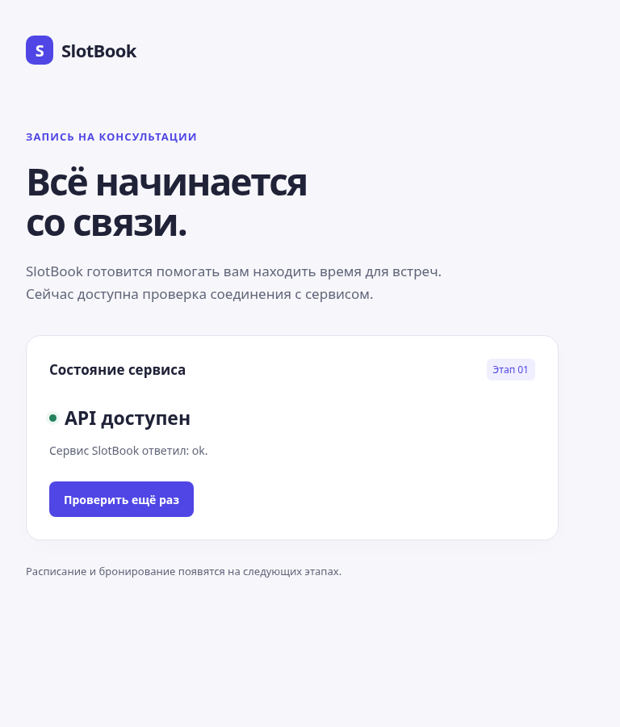
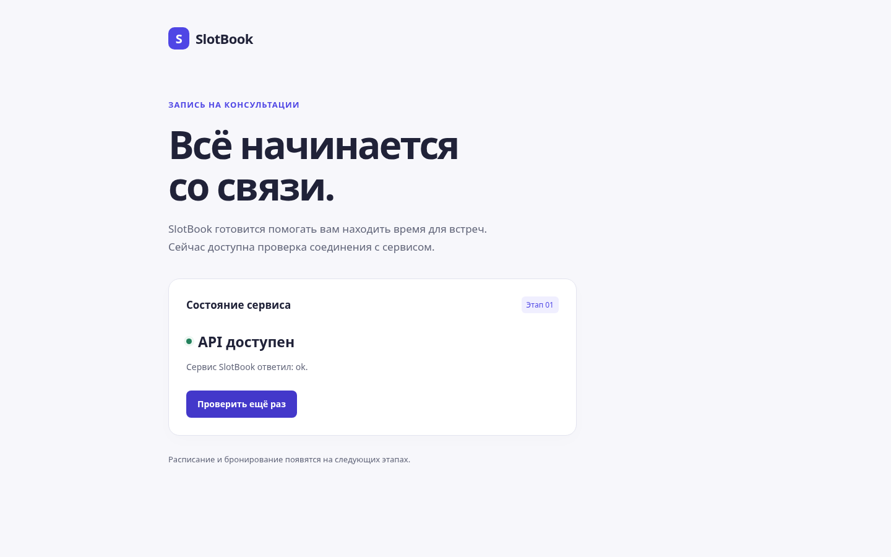

# feat: add React and FastAPI project foundation

Этап 01. Вместо пустого README проект запускает два приложения: React запрашивает
`GET /health/live` через Vite proxy и показывает настоящий ответ FastAPI.
Страница отображает загрузку и ошибку соединения, ограничивает ожидание пятью
секундами и позволяет повторить запрос.

Добавлены настройки backend через env, JSON-логирование, строгий TypeScript,
проверки качества, lock-файлы uv/npm и команды запуска в README/Makefile.
Используются Python 3.14 и Node 24 LTS. База данных, business endpoints,
авторизация и следующие этапы не реализованы.

Проверки:

- `make install`: `uv sync --frozen` и `npm ci` выполнены.
- `make check`: Ruff/format, mypy, pytest (3 passed), ESLint, tsc, Vite build — успешно.
- `PLAYWRIGHT_CHROMIUM_EXECUTABLE_PATH=/usr/bin/chromium make smoke`: 2 passed.
  Подтверждены настоящий HTTP-запрос и повторная проверка, JSON 404 через proxy,
  ошибка сети (намеренно имитируется только в тесте) и восстановление через настоящий API.
- Нет ошибок JavaScript и горизонтального overflow на 390/768/1440 px.
- `git diff --check`: успешно.

Скриншоты реальной страницы:

Ограничения: проверен dev proxy и сборка статики. Production proxy, Docker Compose,
БД, CI и деплой относятся к последующим этапам. Существующий Git remote сохранён;
этот файл — локальный текст для PR, публикация PR и интеграция в main не выполнены.
