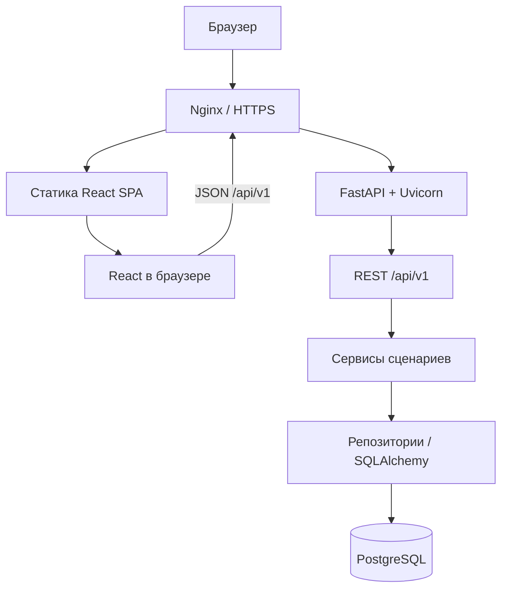

# SlotBook: стек и архитектура

Дата проектирования: 24 октября 2026. Редакция 2: React frontend и поэтапная реализация с Astra. Статус: спецификация; приложение по этому проекту ещё не реализовано.

## 1. Цель и основание выбора

Сервис записи на консультации как основной pet-проект для Junior Python Backend с последующим расширением в Backend + AI.

Источник требований: [Python Backend + AI — подготовка и вакансии](https://docs.google.com/spreadsheets/d/1sFnt6w_6I4H5Y2baJ-xuvkcfF82kp1p6cSj2VwjBRXs/edit), листы «00 Главная», «01 План», «02 Backend», «03 AI и LLM», «04 Инфра», «05 Вакансии», «06 Портфолио».

В 9 строках категории «Цель сейчас» на листе «05 Вакансии»: SQL/БД — 9, Git — 6, Docker — 5, FastAPI — 3, тестирование — 3, Linux — 3. Подсчёт по колонке «Ключевой стек»: SQL/PostgreSQL/DB basics/DB объединены; pytest/tests объединены; учитываются и явно отмеченные плюсы. Это частоты в пользовательской подборке, а не исследование всего рынка. Актуальность самих вакансий заново не проверялась.

SQLAlchemy и Alembic выбраны по P0 в плане подготовки и проекту «Backend Starter». В Solvium указан TortoiseORM: проект даст практику ORM, но не будет демонстрацией именно Tortoise. FastAPI также встречается в Alventa.ai и Innostage из категории Stretch.

Критерий успеха: работающее демо, воспроизводимый запуск, защищённая от гонок запись, миграции, содержательные интеграционные тесты и объяснимая архитектура.

## 2. Границы первой версии

- Один демонстрационный специалист, создаваемый seed-командой. Модель данных допускает нескольких; везде проверяется принадлежность данных владельцу.
- Специалист входит в кабинет, открывает конкретные 30-минутные слоты и смотрит свои записи.
- Клиент без регистрации выбирает время, вводит имя и email, получает подтверждение и секретную ссылку управления записью.
- Отмена до начала консультации освобождает слот; история отмен сохраняется.
- Даты показываются в одном явно подписанном часовом поясе специалиста; исходное значение — Asia/Omsk. В БД абсолютные моменты времени, в API ISO 8601 с offset.
- UI: страница специалиста, выбор даты/слота, подтверждение/отмена, вход, кабинет.
- Регистрация специалистов, платежи, повторяющееся расписание, видеосвязь и синхронизация календарей остаются за пределами MVP.

## 3. Стек

| Область | Решение | Практика для собеседования |
|---|---|---|
| Язык | Python 3.14 | typing, exceptions, context managers, async/await |
| HTTP API | FastAPI + Uvicorn | REST, Depends, middleware, OpenAPI |
| Схемы | Pydantic 2 + pydantic-settings | раздельные input/output, валидация, env |
| БД | PostgreSQL 18 | PK/FK, индексы, транзакции, блокировки |
| ORM | SQLAlchemy 2.x, AsyncSession | SQL, связи, joins, предотвращение N+1 |
| Драйвер | psycopg 3 | async API для приложения; sync API доступен будущему worker |
| Миграции | Alembic | upgrade/downgrade, ручная проверка ограничений |
| Frontend | React 19 + TypeScript strict + Vite | компоненты, типы, формы, маршруты, сборка SPA |
| Дизайн | Tailwind CSS 4 + shadcn/ui + Lucide | единые компоненты, адаптивность, состояния интерфейса |
| Данные frontend | TanStack Query + React Router | серверное состояние, маршруты, обновление данных |
| Формы | React Hook Form + Zod | проверка пользовательского ввода и доступные ошибки |
| Контракт | OpenAPI → openapi-typescript + небольшой fetch client | типы ответов из backend, согласованность API |
| Авторизация | Серверные сессии в PostgreSQL; pwdlib/Argon2 | проверка пароля, отзыв сессии, права владельца |
| Тесты backend | pytest + pytest-asyncio + HTTPX | unit, API, интеграция с настоящим PostgreSQL |
| Тесты frontend | Vitest + Testing Library; Playwright для сквозных сценариев | поведение форм, доступность, настоящий браузер |
| Качество | Ruff + mypy; ESLint + tsc | единые правила и проверка типов |
| Зависимости | uv + uv.lock; npm + package-lock.json | повторяемое окружение обеих частей |
| Запуск | Docker + Docker Compose | сервисы, healthchecks, volumes |
| Деплой | Linux VPS, Nginx, HTTPS | reverse proxy, логи, эксплуатация |
| CI | GitHub Actions | lint, types, migrations, tests, build |
| Логи | logging, JSON formatter, request_id | диагностика запроса и ошибок |

Точные patch-версии фиксируются и проверяются совместно в lock-файле при реализации. SQLAlchemy — одна выбранная стабильная линия 2.x, без плавающего обновления в production. Для psycopg используется поддерживаемый SQLAlchemy async engine. См. [диалект psycopg](https://docs.sqlalchemy.org/en/20/dialects/postgresql.html#module-sqlalchemy.dialects.postgresql.psycopg).

Frontend обновлён по прямому пожеланию пользователя. Он не выводится из частоты frontend-требований в исходной таблице. Выбран React SPA: Python остаётся единственным backend. Vite собирает статические файлы; production Node-сервер для этой схемы не требуется. Основание: [React + Vite](https://react.dev/learn/build-a-react-app-from-scratch), [shadcn/ui для Vite](https://ui.shadcn.com/docs/installation/vite).

Красивый интерфейс требует отдельного дизайн-прохода: согласованные отступы, типографика, ясные действия, мобильный экран и состояния loading/empty/error/success. Подключение React само по себе это не обеспечивает.

### После готового MVP

1. Redis: общий rate limit на публичную запись и вход. Кэшировать можно публичный профиль специалиста с TTL и сбросом после изменения. Доступность слотов продолжает читаться из PostgreSQL.
2. Celery + RabbitMQ + HTTPX: фоновая интеграция с email-провайдером, ограниченные повторы, transactional outbox. Redis не используется вторым брокером.
3. AI: преобразование текстового пожелания клиента в валидированные параметры поиска времени; затем обычный сервис ищет реальные слоты. Подтверждение бронирования остаётся явным действием пользователя.

## 4. Архитектура приложения

Один репозиторий с frontend/ и backend/. Backend — модульный монолит FastAPI с одной основной БД. React — отдельное клиентское приложение. Расширение очередями запускает дополнительные backend-процессы из того же репозитория.



React обращается к /api/v1 по JSON. FastAPI не рендерит страницы. В разработке Vite proxy направляет /api и /health в backend; production Nginx отдаёт frontend/dist и проксирует /api, /health, /docs и /openapi.json в FastAPI. Остальные клиентские маршруты получают index.html, включая прямое открытие /manage/<id> и /dashboard. API 404 не превращается в HTML. Один origin сохраняет cookie-сессии без отдельной cross-origin схемы.

Модули:

- `auth`: вход/выход, сессии, current_user, CSRF.
- `specialists`: публичный профиль и настройки владельца.
- `slots`: публикация, закрытие, выборка свободного времени.
- `bookings`: запись, отмена, права доступа, история.
- `notifications`: только этап расширения; события и внешний клиент.
- `ai`: только этап AI; адаптер модели и схемы результата.

Внутри модуля: router → service → repository. Router переводит HTTP в вызов сценария; service проверяет правила и задаёт границы транзакции; repository выполняет SQL без самостоятельного commit. Pydantic-схемы не совпадают с ORM-моделями: публичный ответ не содержит email других клиентов, password_hash или секреты.

Одна AsyncSession используется одной выполняющейся задачей; нельзя раздавать одну сессию параллельным coroutine. FastAPI dependency отвечает за её жизненный цикл, сервис записи — за begin/commit/rollback. Проверка пользователя может выполнить предварительный SELECT; перед началом бизнес-транзакции этот read-only блок должен быть завершён. Это предотвращает конфликт с SQLAlchemy autobegin. См. [правила конкурентной работы с Session](https://docs.sqlalchemy.org/en/20/orm/session_basics.html#is-the-session-thread-safe-is-asyncsession-safe-to-share-in-concurrent-tasks).

Не вводим generic BaseRepository, шину событий и собственный DI-контейнер. Достаточно явных зависимостей FastAPI и небольших сервисов.

## 5. Модель данных

Все идентификаторы — UUID. Моменты времени — timestamptz; строка IANA timezone хранится отдельно, потому что timestamptz не сохраняет название исходного часового пояса.

| Таблица | Основные поля и ограничения |
|---|---|
| users | id; normalized_email UNIQUE NOT NULL; password_hash NOT NULL; created_at |
| sessions | id; user_id FK; token_hash UNIQUE; csrf_token_hash; expires_at |
| specialists | id; user_id FK UNIQUE; slug UNIQUE; display_name; timezone |
| slots | id; specialist_id FK; starts_at; ends_at; state open/closed; CHECK ends_at > starts_at |
| bookings | id; slot_id FK; client_name; client_email; status confirmed/cancelled; manage_token_hash UNIQUE; created_at; cancelled_at |

Связи: users 1 → 0..1 specialists; users 1 → N sessions; specialists 1 → N slots; slots 1 → N bookings за всю историю. Одновременно активной может быть только одна запись на слот.

Слоты не удаляются после создания; закрываются. Их время неизменно: для изменения времени создаётся другой слот. Закрытие занятого слота отклоняется с 409; сначала владелец явно отменяет запись. Отмена клиента освобождает только open-слот. После начала консультации self-service отмена недоступна.

Индексы:

- slots(specialist_id, starts_at) WHERE state = 'open' — поиск в диапазоне дат.
- bookings(slot_id) UNIQUE WHERE status = 'confirmed' — гарантия единственной активной записи.
- bookings(slot_id, created_at) — история и список записей через JOIN со slots.
- sessions(token_hash) UNIQUE — получение сессии; sessions(expires_at) — очистка.

Создание двух пересекающихся слотов у одного специалиста тоже запрещается. Иначе два разных slot_id могли бы означать одно и то же время. В миграции используются btree_gist и exclusion constraint:

```sql
CREATE EXTENSION IF NOT EXISTS btree_gist;

ALTER TABLE slots ADD CONSTRAINT no_overlapping_slots
EXCLUDE USING gist (
    specialist_id WITH =,
    tstzrange(starts_at, ends_at, '[)') WITH &&
);

CREATE UNIQUE INDEX one_confirmed_booking_per_slot
ON bookings (slot_id)
WHERE status = 'confirmed';
```

Ограничение пересечения распространяется на все слоты, включая закрытые: существующий слот открывается повторно, а дубликат не создаётся. Интервал [start, end) разрешает соседние 15:00–15:30 и 15:30–16:00. Длительность 30 минут задаётся проверкой входа и CHECK в миграции.

Основание: [PostgreSQL: ограничения диапазонов](https://www.postgresql.org/docs/current/rangetypes.html#RANGETYPES-CONSTRAINT) и [уникальные частичные индексы](https://www.postgresql.org/docs/current/sql-createindex.html).

## 6. Ключевой сценарий и конкурентность

POST /api/v1/bookings:

1. Pydantic проверяет UUID, имя, email; тело запроса ограничено по размеру.
2. BookingService открывает транзакцию и получает нужный слот через SELECT ... FOR UPDATE.
3. Проверяет state=open и starts_at позже текущего времени БД; затем наличие активной записи. Время проверяется после получения блокировки.
4. Создаёт booking и секрет управления, сохраняет только SHA-256 секрета, выполняет INSERT.
5. Фиксирует транзакцию. Только после успешного commit возвращает 201 и подтверждение.

Конкурентный запрос ждёт блокировку, затем видит занятую запись и получает 409 slot_unavailable. Частичный UNIQUE — дополнительная гарантия в БД, даже если другой участок кода забудет проверку.

BookingService.cancel и SlotService.close также сначала блокируют тот же слот, затем меняют связанные записи. Порядок блокировок одинаков: slot → booking. Повторная отмена уже отменённой записи возвращает успешный результат; новый booking того же слота она не отменяет. Конфликт конкретного уникального ограничения преобразуется в 409 после rollback; остальные IntegrityError не маскируются под занятое время.

Клиент может увидеть свободное время, которое успели занять до подтверждения. Это нормальная ситуация: источник окончательного решения — транзакция бронирования. Redis и блокировка кнопки не обеспечивают эту гарантию.

В MVP POST создания не гарантирует повтор исходного ответа при сетевом обрыве после commit: повтор может получить 409. Это документируется. Долговременный Idempotency-Key с проверкой fingerprint и безопасным повтором ответа — отдельное расширение, не подменяемое одной проверкой занятости.

## 7. HTTP API

Префикс /api/v1. Для списков — limit с верхним пределом и offset; для свободных слотов обязателен ограниченный диапазон from/to, максимум 31 день.

| Метод и путь | Доступ | Результат |
|---|---|---|
| POST /auth/login | публичный | cookie сессии; 204 |
| POST /auth/logout | владелец + CSRF | отзыв сессии; 204 |
| GET /auth/me | владелец | текущий пользователь и CSRF-токен |
| GET /specialists/{slug} | публичный | профиль без приватных полей |
| GET /specialists/{slug}/slots?from=&to= | публичный | только будущие свободные open-слоты |
| POST /slots | владелец + CSRF | новый слот; 201; конфликт интервала 409 |
| PATCH /slots/{id} | владелец + CSRF | изменение state; чужой слот 404 |
| POST /bookings | публичный | slot_id, client_name, client_email → 201; занято 409 |
| GET /bookings/{id} | владелец либо секрет клиента | детали конкретной записи |
| POST /bookings/{id}/cancel | владелец + CSRF либо секрет клиента | отмена; 200 |
| GET /me/bookings?from=&to=&status= | владелец | собственные записи через slots/specialists |
| GET /health/live | инфраструктура | процесс жив |
| GET /health/ready | инфраструктура | доступна БД и применена ожидаемая миграция |

Ошибка имеет вид {"error":{"code":"slot_unavailable","message":"Это время уже занято","request_id":"..."}}. Валидация — 422; нет сессии — 401; неверный CSRF — 403; чужой или недоступный объект — 404; бизнес-конфликт — 409; превышение лимита — 429. UUID записи сам по себе не даёт доступ.

## 8. Авторизация и работа с секретами

- Для владельца: случайный непрозрачный session token в cookie HttpOnly, Secure, SameSite=Lax; хеш в PostgreSQL; ограниченный срок жизни и отзыв при выходе. Пароль — Argon2 через pwdlib. Самостоятельная регистрация в MVP отсутствует.
- Для изменения данных с cookie-сессией: CSRF-токен и проверка Origin. Один домен для UI и API.
- Клиентский manage token: минимум 256 случайных бит; в БД только хеш. Ссылка управления использует fragment, например /manage/<booking-id>#token=...; небольшой JS переносит секрет в память и сразу убирает fragment из адресной строки. API получает его в Authorization: Bearer. При обновлении страницы пользователь повторно открывает сохранённую ссылку. POST отмены требует явного нажатия; GET ничего не отменяет.
- Страницы подтверждения/управления и API с личными данными: Cache-Control: no-store, Referrer-Policy: no-referrer. Секреты, пароли и тела с контактами не попадают в логи.
- Базовый лимит входа и записи через Nginx в MVP; Redis добавляет общий прикладной лимит в следующем этапе. Лимит по IP — лишь базовая мера, а не полноценная защита от злоупотреблений.
- Вход только под явно созданным владельцем. Публичный demo-режим работает с отдельными синтетическими данными и не предоставляет общий доступ к реальным записям.

## 9. Расширение: уведомления и очереди

Цель: показать внешний API, timeout, retry, broker/worker и восстановление после сбоя без задержки ответа клиенту.

Добавляются outbox_events и notification_deliveries. Booking и outbox event записываются в одной транзакции. Отдельный dispatcher читает outbox, публикует persistent message в durable RabbitMQ queue с publisher confirm, затем помечает событие опубликованным. Сбой между публикацией и отметкой допускает дубликат.

Celery worker использует стабильный event_id, проверяет доставку и делает вызов email API через HTTPX с connect/read timeout. Повторяет сетевые ошибки, 429 и подходящие 5xx с ограничением попыток, backoff и jitter; учитывает Retry-After. Постоянные 4xx не повторяет автоматически. Обычные синхронные Celery tasks используют отдельные sync DB session и HTTPX Client.

При наличии idempotency у провайдера передаётся event_id. UNIQUE(event_id, channel) и статусы deliveries уменьшают повторы, но сами по себе не закрывают сбой после внешней отправки до commit. Без idempotency провайдера повторное письмо остаётся возможным; гарантия — at-least-once, а не exactly-once. Исчерпанные попытки видны в БД и логах и доступны для явного повторного запуска.

Celery документирует [retry, backoff и jitter](https://docs.celeryq.dev/en/stable/userguide/tasks.html). На этом этапе добавляются тесты сбоя брокера и повторной доставки события. Длительные напоминания на недели вперёд не хранятся в countdown Celery; планировщик напоминаний — отдельная следующая задача.

## 10. Расширение: AI

Пример ввода: «Хочу консультацию во вторник после трёх». Модуль передаёт модели текущую дату и timezone специалиста и получает строго проверяемую структуру: date, time_from, time_to, needs_clarification. Неоднозначный ввод требует уточнения; модель не выдумывает доступность.

Обычный SlotService выбирает действительные слоты из PostgreSQL. При tool calling инструмент read-only list_available_slots имеет ограниченный диапазон и разрешённый specialist_id. Создание записи проходит обычный endpoint после подтверждения пользователя и заново проверяет доступность.

Модель изолирована адаптером LLMClient; credentials через env; timeout, лимит размера ввода, журнал latency/errors без контактов клиента. Конкретный поставщик и модель выбираются при реализации. 20–30 примеров для eval: относительные даты, пустой день, неоднозначное время, неверный JSON, timeout и попытка вызвать неразрешённый инструмент.

RAG/pgvector/Qdrant полезны при появлении реальной базы знаний специалиста; они не требуются для подбора слотов. LangGraph добавляется при появлении нескольких шагов диалога со состоянием и уточнениями. Это согласуется с P1-специализацией в таблице и сохраняет небольшой MVP.

## 11. Структура репозитория

```text
slotbook/
  backend/
    app/
      main.py
      core/               # settings, db, security, errors, logging
      modules/
        auth/
        specialists/
        slots/
        bookings/         # router.py, schemas.py, models.py, service.py, repository.py
    migrations/           # Alembic, включая constraints
    tests/
      unit/
      integration/
      concurrency/
    scripts/              # seed_demo, demo_concurrent_booking, export_openapi
    pyproject.toml
    uv.lock
    Dockerfile
  frontend/
    src/
      app/                # router, providers, app shell
      pages/              # specialist, manage, login, dashboard, not-found
      features/           # auth, slots, booking, schedule
      components/ui/      # shadcn/ui
      lib/                # api client, formatters, query keys
      generated/          # api-types.ts, генерируется из OpenAPI
      styles/
    tests/
    package.json
    package-lock.json
    vite.config.ts
    tsconfig.json
  e2e/                    # Playwright и отдельные тестовые данные
  deploy/nginx.conf
  docs/                   # архитектура, контракты, этапы, решения, учебный разбор
  .github/workflows/ci.yml
  .env.example
  .gitignore
  compose.yaml
  README.md
```

notifications/, ai/ и worker добавляются при реализации соответствующего этапа, а не пустыми абстракциями заранее.

### Frontend: экраны и состояние

- /s/:slug — карточка специалиста, выбор дня и времени, форма записи. На desktop две колонки, на мобильном одна; выбранное время видно рядом с подтверждением.
- /manage/:id — подтверждение/отмена по секретной ссылке. Секрет захватывается из fragment до инициализации router, затем fragment удаляется. Инициализация не должна терять секрет при повторном mount в React StrictMode.
- /login — форма входа владельца.
- /dashboard — ближайшие записи, фильтр по датам и статусам.
- /dashboard/schedule — публикация/закрытие слотов, недельный вид.
- Состояния: skeleton, пустое расписание, нет свободных слотов, ошибка сети, 409 занятого времени, 422 ошибок формы, истёкшая сессия, подтверждение отмены.

Дизайн: светлая нейтральная основа, один индиго-акцент, читаемая типографика, явный timezone, единые cards/buttons/inputs/dialogs. Проверка на ширинах 390, 768 и 1440 px; клавиатура, видимый focus, подписи полей, reduced motion. Сложные анимации и тяжёлый календарный пакет для MVP не нужны.

TanStack Query хранит серверные данные; React state — выбранную дату, открытые диалоги и локальные UI-состояния. Отдельный глобальный store пока не требуется. После успешной записи/отмены инвалидируются связанные queries. Optimistic success для бронирования отсутствует: подтверждение показывается после ответа API. Mutations создания записи не повторяются автоматически; сетевой обрыв после commit имеет ограничение из раздела 6. Для GET политика retry задаётся явно и не повторяет 401/403/404. См. [TanStack Query mutations](https://tanstack.com/query/latest/docs/framework/react/guides/mutations).

Клиент fetch имеет base path /api/v1, credentials, поддержку AbortSignal, типизированную ошибку и CSRF header для cookie-auth mutations. Manage token хранится только в памяти, не в localStorage и не в сохраняемом query cache. Logout очищает приватные queries. Frontend guard управляет навигацией, backend проверяет права независимо от него.

Pydantic/OpenAPI — источник HTTP-типов. Экспорт схемы не требует соединения с production-БД; генерация api-types.ts воспроизводится командой и проверяется в CI. Zod отвечает за UX-валидацию формы, бизнес-правила повторно проверяет backend. MSW допускается для демонстрации состояний в компонентных тестах, но production UI и сквозные тесты используют настоящий API.

## 12. Проверка качества

Интеграционные и конкурентные тесты работают на PostgreSQL той же major-версии, что и приложение. SQLite не проверяет используемые ограничения и блокировки. Перед тестами применяются настоящие миграции.

Обязательные сценарии:

1. Свободный слот успешно бронируется; закрытый, прошедший и занятый — отклоняются.
2. 20 независимых конкурентных HTTP-запросов с отдельными DB session бронируют один слот: один 201, остальные 409, в БД одна confirmed-запись. Тест запускается с барьером старта и ограниченным timeout.
3. Пересечение двух разных слотов одного специалиста отклоняется; соседние интервалы и те же часы разных специалистов разрешены.
4. Отмена освобождает слот; повторная отмена старой записи не отменяет новую запись на него.
5. Гонка закрытия слота и бронирования даёт согласованное состояние; closed-слот не получает активную запись.
6. Второй пользователь не может видеть контакты и менять расписание первого; неверный клиентский token не даёт доступ.
7. Cookie-запрос изменения без CSRF отклоняется; logout отзывает сессию.
8. Наивные даты/время без timezone отклоняются; граничное начало слота и переход календарной даты обрабатываются правильно.
9. Частичная ошибка сценария откатывает всю транзакцию. Миграции проходят upgrade → downgrade → upgrade в одноразовой тестовой БД.
10. Для расширения: timeout/429/5xx email API, падение брокера, повтор event_id и исчерпание retry.

Дополнительно frontend: Vitest/Testing Library проверяют реакцию формы на 409/422 и отсутствие повторной отправки; Playwright проверяет запись → отмену → повторную запись, вход → публикацию слота, 401 и прямое открытие /manage/:id через production Nginx. Визуальная проверка проводится в настоящем браузере на трёх ширинах, с сохранением скриншотов.

CI состоит из backend-проверок (uv sync --frozen, Ruff, mypy, PostgreSQL, Alembic, pytest), frontend-проверок (npm ci, ESLint, tsc, Vitest, build, проверка OpenAPI-типов) и сквозных тестов Compose/Playwright. Проверку downgrade выполнять только в одноразовой CI-БД. Релиз блокируется при провале обязательного шага. Бейдж покрытия не заменяет сценарии выше.

## 13. Запуск и эксплуатация

MVP Compose: db + одноразовый migrate + api + nginx со статической сборкой frontend. Отдельный frontend build stage использует закреплённую совместимую Node LTS; production-контейнер содержит только результат сборки и Nginx. Миграции запускаются один раз до API, а не каждым Uvicorn worker. Seed — явная идемпотентная команда. Для разработки Vite и API могут запускаться отдельно, соединяясь через proxy.

Production: Linux VPS, HTTPS, закрытые снаружи порты БД, persistent volume и резервные копии с проверкой восстановления. Uvicorn внутри собственного Docker image; число workers небольшое и согласовано с размером DB pool. Современный Uvicorn поддерживает workers; отдельный Gunicorn для этой схемы не обязателен: [FastAPI deployment](https://fastapi.tiangolo.com/deployment/docker/).

Readiness проверяет БД; после добавления очередей сбой email не отключает возможность бронирования. Outbox накапливает события. В логах: request_id, маршрут, статус, duration, booking_id и коды ошибок; без токенов и контактных данных. Неудавшиеся уведомления отслеживаются отдельно.

## 14. Порядок реализации и оценка

| Этап | Результат | Критерий готовности |
|---|---|---|
| 1 | Каркас backend + React, Compose, контракт API | Проверяемый старт двух частей |
| 2 | Модели, миграции, seed, read API | Настоящее расписание в React |
| 3 | Booking/cancel, транзакции, конкурентные тесты | Рабочая публичная запись |
| 4 | Сессии, права, кабинет React, CSRF | Рабочее управление расписанием |
| 5 | Browser QA, CI, production build, аудит | Проверенный MVP |
| 6 | Демо, документация и маршрут изучения | Проект для портфолио |

Порядок работы изменён по пожеланию пользователя: сначала реализация с помощью Codex/Astra и проверка результата, затем подробное изучение готового кода. Предыдущая оценка 30–45 часов относилась к ручному освоению backend и простому UI; она не переносится автоматически на React-проект с агентной разработкой. После первых двух этапов следует оценить фактические затраты. Время генерации, проверки, исправлений и учебного разбора учитывается отдельно; фиксированный срок заранее не обещается.

Детальные карточки задач, критерии готовности и рекомендации по Astra находятся в [плане разработки](slotbook-astra-plan.md). Первая версия считается законченной после этапов 01–12. Полный запланированный объём включает расширения 13–15 с повторной проверкой релиза. Подготовка этой спецификации не означает, что реализация или проверки уже выполнены.

## 15. Что показать работодателю

- Ссылку на демо и Swagger; синтетические данные и отдельный демонстрационный режим.
- Сценарий: открыть время → записаться → показать конфликт второй записи → отменить → записаться снова.
- Тест 20 конкурентных запросов и фактическую гарантию индекса в PostgreSQL.
- ER-схему, один service с транзакцией, понятные запросы и объяснение индексов.
- Запуск с чистого окружения, миграции и проходящий CI.
- README: проблема, возможности, архитектура, запуск, переменные окружения, тесты, решения и известные ограничения.

Формулировка для резюме допустима после реализации и проверки: «Разработал сервис бронирования на FastAPI/PostgreSQL с SQLAlchemy, Alembic, интеграционными тестами и Docker. Защитил бронирование от конкурентных запросов ограничениями БД и транзакциями; настроил CI и деплой».
