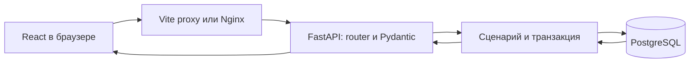
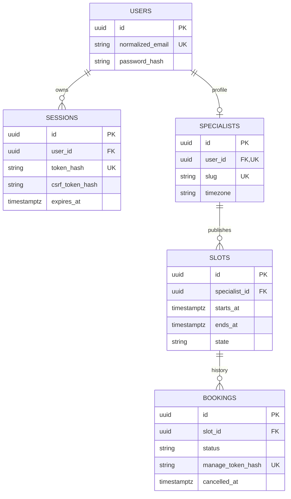

# Как устроен SlotBook

Начните с [демонстрации](demo.md). Ниже ссылки на исполняемый код, а не на будущую
архитектуру. В разработке React и FastAPI соединяет Vite proxy; в Docker — Nginx.

## Запись на консультацию: от кнопки до commit

1. [Страница специалиста](../frontend/src/pages/specialist.tsx) запрашивает профиль
   и свободные слоты. [dates.ts](../frontend/src/lib/dates.ts) строит границы дня
   в timezone специалиста; в API уходят моменты времени с offset/UTC.
2. [BookingForm](../frontend/src/components/booking/booking-form.tsx) проверяет имя
   и email через React Hook Form/Zod и блокирует повторную отправку. `createBooking`
   в [api.ts](../frontend/src/lib/api.ts) делает один POST `/api/v1/bookings`.
   В теле только `slot_id`, `client_name`, `client_email`; клиент не назначает цену,
   состояние записи или идентификатор владельца.
3. [Router](../backend/app/modules/bookings/router.py) принимает
   [BookingCreate](../backend/app/modules/bookings/schemas.py). Pydantic отклоняет
   неизвестные поля и неправильные данные. [BodyLimitMiddleware](../backend/app/core/body_limit.py)
   ограничивает фактически прочитанные байты до разбора JSON.
4. [BookingService.create](../backend/app/modules/bookings/service.py) открывает
   `session.begin()`. [Repository](../backend/app/modules/bookings/repository.py)
   читает слот с `SELECT … FOR UPDATE`. Конкурирующая запись ждёт эту блокировку.
5. После ожидания сервер сравнивает начало слота с `clock_timestamp()` БД,
   проверяет `open` и отсутствие confirmed-записи. Генерирует случайный manage token,
   сохраняет только SHA-256-хеш и делает `flush()`.
6. `flush()` отправляет SQL, но ещё не гарантирует commit. Выход из `begin()`
   фиксирует транзакцию. Только после этого сервис возвращает `BookingCreated`
   с исходным токеном. При ошибке транзакция откатывается.
7. React показывает [подтверждение](../frontend/src/components/booking/confirmation.tsx)
   с `/manage/<id>#token=…`. Токен не попадает в query keys или mutation data.
   При 409 список свободных слотов обновляется; при потере ответа интерфейс
   предупреждает, что запись могла сохраниться, и не повторяет POST вслепую.

При двух конкурентных запросах блокировка сериализует работу с одним слотом.
Дополнительно частичный уникальный индекс PostgreSQL допускает только одну
confirmed-запись на слот. Правило обеспечивается сервером и БД независимо от UI.
[Тесты бронирования](../backend/tests/integration/test_bookings.py) проверяют
20 параллельных TCP-запросов, откат после flush и время после ожидания блокировки.

## Данные и ограничения

Диаграмма сокращена; полный набор полей — в [models.py](../backend/app/models.py).
Применяемая схема хранится в [миграциях](../backend/migrations/versions/).

| Правило | Где гарантируется |
|---|---|
| Длительность слота ровно 30 минут | Pydantic SlotCreate и CHECK `slot_duration` |
| Нет пересечений слотов специалиста, включая закрытые | GiST EXCLUDE `no_overlapping_slots`, интервал `[start,end)` |
| Не больше одной confirmed-записи | Частичный unique index `one_confirmed_booking_per_slot` |
| Отмена сохраняет историю | Статус cancelled и CHECK `booking_cancellation_state` |
| Нельзя удалить связанные данные случайно | FK с `ON DELETE RESTRICT` |
| Контакты видны только владельцу/по токену | SQL-фильтры owner router и `authorize` в BookingService |

`timestamptz` хранит момент времени, а не название часового пояса. IANA timezone
профиля применяется при показе календаря. [owner-dates.ts](../frontend/src/lib/owner-dates.ts)
отклоняет неоднозначное/несуществующее местное время при переходах DST.

## Чтение и отмена по секретной ссылке

[manage-token.ts](../frontend/src/lib/manage-token.ts) захватывает fragment до React,
очищает URL через `replaceState` и держит credential в памяти. Fragment браузер
не отправляет HTTP-серверу. [ManagePage](../frontend/src/pages/manage.tsx) передаёт
токен через `Authorization: Bearer`. Отсутствующий/неверный токен даёт одинаковый 404.

`BookingService.cancel` сначала авторизует чтение, затем блокирует слот и запись
именно в этом порядке. После ожидания ORM-объект обновляется. До начала встречи
статус становится cancelled; повторная отмена не затрагивает новую запись на тот
же слот и возвращает прежний результат. Закрытый слот отмена не открывает.

## Кабинет и сессии

[Owner router](../backend/app/modules/owner/router.py) сверяет Argon2id-хеш пароля
в отдельном потоке и выдаёт HttpOnly/SameSite=Lax cookie; при HTTPS он Secure.
В БД хранятся хеши session/CSRF, срок сессии — 12 часов. Повторный вход заменяет
сессию текущего браузера; выход отзывает её.

[owner_context](../backend/app/modules/owner/dependencies.py) открывает транзакцию
до первого чтения, блокирует строку сессии, проверяет срок, а для изменений — Origin
и CSRF. Dependency имеет `scope="function"`: commit происходит до отправки ответа.
Запросы к слотам/записям фильтруются по текущему владельцу. Закрытие слота блокирует
тот же slot row, что и бронирование, поэтому два действия не могут противоречить друг другу.

[OwnerLayout](../frontend/src/components/owner/layout.tsx) скрывает кабинет на время
повторной проверки входа. [owner-session.ts](../frontend/src/lib/owner-session.ts)
отменяет приватные запросы перед очисткой кэша; поздний ответ не восстанавливает
данные вышедшего пользователя. Клиентский guard дополняет серверную авторизацию.

## Контракт, ошибки и запуск

[main.py](../backend/app/main.py) создаёт engine в lifespan и закрывает его при
остановке. [get_session](../backend/app/core/db.py) предоставляет отдельную AsyncSession
на запрос. JSON-ошибки и безопасные логи задаёт [errors.py](../backend/app/core/errors.py).

[OpenAPI](openapi.json) экспортируется без БД из Pydantic; [api-types.ts](../frontend/src/generated/api-types.ts)
генерируется из него. `make api-check` обнаруживает расхождения. Zod нужен для UX,
а сервер повторно проверяет данные и бизнес-правила.

[Production Compose](../compose.production.yaml) запускает db → migrate → api → nginx.
Readiness проверяет и доступность БД, и точные migration heads. [Nginx](../frontend/nginx.conf)
отдаёт статику и обновляет IP API через Docker DNS. Проверка [check-production.sh](../scripts/check-production.sh)
использует собственный volume, имитирует смену IP/отказ БД и удаляет только свои данные.
